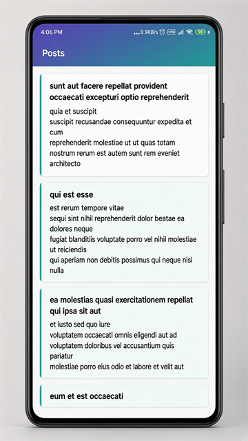

# HmyhAndroidStarter

A simple Android starter app that shows a list of posts.



The app loads posts from [JSONPlaceholder](https://jsonplaceholder.typicode.com/posts), saves them in a local Room database, and displays them in a Jetpack Compose list (title + body for each post).

---

## What you need

| Requirement | Value |
| --- | --- |
| Android Studio | Latest stable (recommended) |
| JDK | 17 |
| Min SDK | 26 |
| Target / Compile SDK | 37 |
| Internet | Needed for live API data (offline sample data is bundled) |

---

## Tech stack

| Area | Technology |
| --- | --- |
| Language | Kotlin |
| UI | Jetpack Compose + Material 3 |
| Architecture | MVVM + Clean Architecture |
| DI | Dagger Hilt |
| Local DB | Room |
| Network | Retrofit + OkHttp |
| JSON | Kotlin Serialization |
| Async | Coroutines + Flow |
| Build | Gradle Version Catalog + KSP |

---

## How the app works

1. The screen reads posts from **Room** (source of truth).
2. On start (and Retry), the app calls the **API** and saves results into Room.
3. The UI updates automatically when Room data changes.
4. If the network fails and the DB is empty, the app loads sample posts from `assets/posts.json`.

```
UI (Compose) → ViewModel → Use Case → Repository → Room / Retrofit
```

---

## Project structure

```
app/src/main/java/com/hmyh/androidstarter/
├── App.kt                          # Hilt Application
├── MainActivity.kt                 # Single Activity host
├── core/
│   ├── common/                     # AppResult, AppError
│   └── database/                   # AppDatabase, PostEntity, PostDao
├── di/                             # App-wide Hilt modules (Network, DB, Dispatchers)
├── feature/post/
│   ├── domain/                     # Model, repository interface, use cases
│   ├── data/                       # API, DTO, mapper, repository impl, assets loader
│   ├── di/                         # Feature Hilt module
│   └── presentation/               # Screen, ViewModel, UiState
└── ui/theme/                       # Compose theme
```

### Layer guide (simple rules)

| Layer | Role | Depends on |
| --- | --- | --- |
| **presentation** | Screens + ViewModel | domain only |
| **domain** | Business logic (use cases, models) | Kotlin only |
| **data** | API + DB + repository implementation | domain + core |
| **core** | Shared DB and result types | nothing from feature |
| **di** | Wires dependencies with Hilt | modules it provides |

---

## Key files for the Posts screen

| File | Purpose |
| --- | --- |
| `PostsScreen.kt` | Compose UI (list of title + body) |
| `PostsViewModel.kt` | Holds UI state, triggers refresh |
| `ObservePostsUseCase.kt` | Watches Room for post updates |
| `RefreshPostsUseCase.kt` | Fetches from network into Room |
| `PostRepositoryImpl.kt` | API + DB + offline fallback |
| `PostApi.kt` | Retrofit endpoint |
| `assets/posts.json` | Offline sample posts |

---

## Build and run

1. Open the project in **Android Studio**.
2. Wait for Gradle sync.
3. Run the `app` configuration on an emulator or device.

Or from a terminal:

```bash
gradlew.bat :app:assembleDebug
```

Run unit tests:

```bash
gradlew.bat :app:testDebugUnitTest
```

> Note: `local.properties` is created by Android Studio and is not committed.

---

## Requirements summary

- Kotlin Android app with Compose UI
- Clean Architecture (domain / data / presentation)
- Offline-first with Room
- Network with Retrofit
- Dependency injection with Hilt
- Sample feature: **Posts list** from JSONPlaceholder
- Unit tests for the ViewModel

---

## More detail

For a deeper walkthrough (migration notes, adding a new feature, reusing this as a template), see [Documentation.md](Documentation.md).
